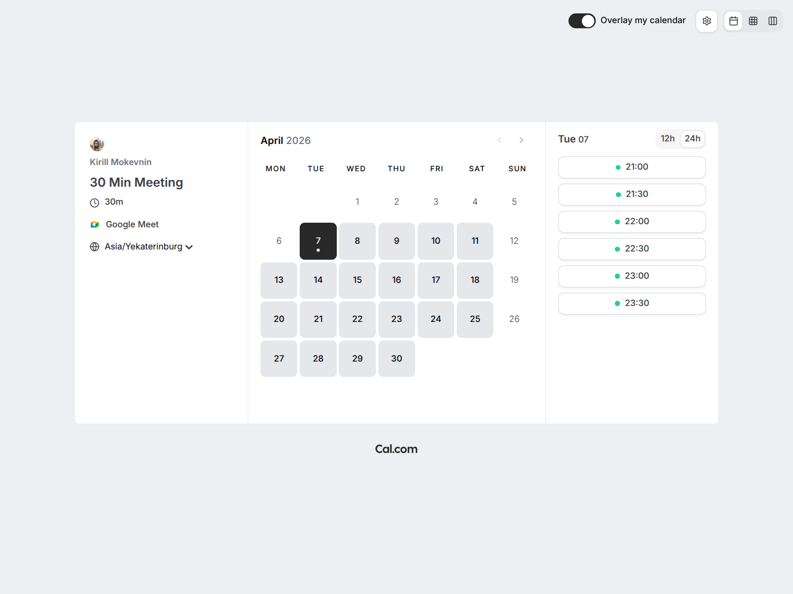
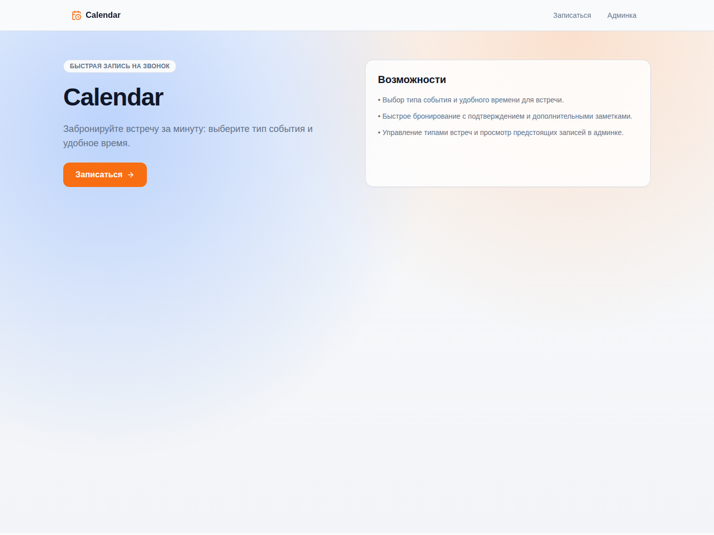
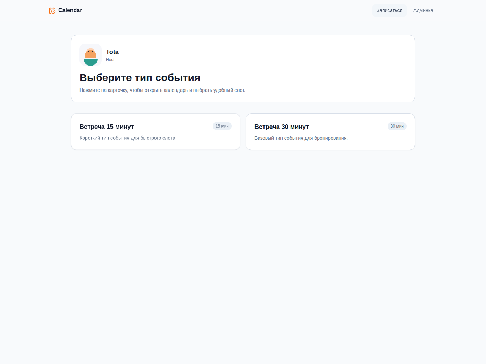
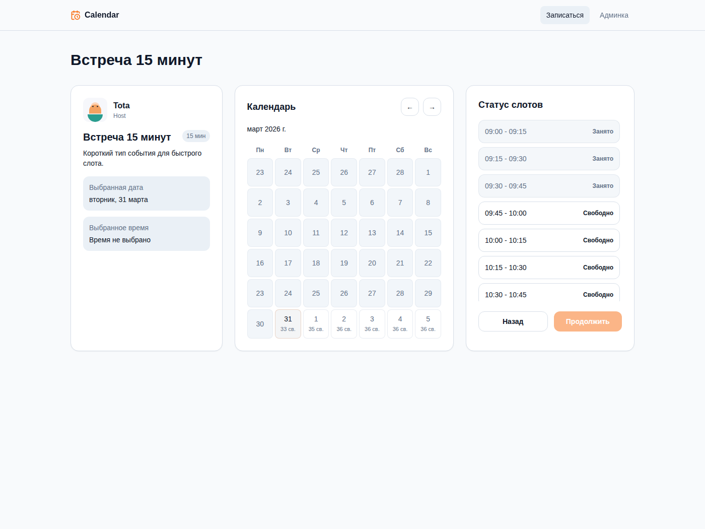

# Календарь звонков

[](https://github.com/Fomikadze/ai-for-developers-project-386/actions)

Разработайте совместно с ИИ сервис для бронирования календаря

Учебный проект Хекслета: <https://ru.hexlet.io/programs/ai-for-developers>
Как это должно работать: <https://files.hexlet.app/a/2ipc5m>

## Описание проекта

«Запись на звонок» это упрощённый сервис бронирования времени по мотивам Cal.com.



Cal.com это сервис, где пользователь публикует доступные интервалы, а другой человек выбирает свободное время и бронирует встречу. У данного приложения тот же базовый сценарий: владелец публикует доступное время для встреч, а другой пользователь выбирает свободный слот и записывается на звонок.

В проекте нет авторизации, личных кабинетов и интеграций с внешними календарями. Функциональность намеренно ограничена, чтобы сосредоточиться на главном.

В результате должно получиться небольшое, но законченное приложение.

Пример того, что должно получиться:





## Документация для ИИ-агента

Подробности лежат в [docs/](docs/). Перед началом задачи прочитай все файлы, условия которых подходят. Если не уверен, начни с `requirements.md`.

| Файл | Читай, если задача |
| --- | --- |
| [docs/requirements.md](docs/requirements.md) | добавляет или меняет поведение приложения: любую фичу, экран или эндпоинт |
| [docs/schedule.md](docs/schedule.md) | касается слотов, окна записи, рабочих часов, часового пояса или пересечений броней |
| [docs/api.md](docs/api.md) | меняет `typespec/`, эндпоинты, поля запросов и ответов, коды ошибок или SDK |
| [docs/architecture.md](docs/architecture.md) | меняет код в `backend/` |
| [docs/frontend.md](docs/frontend.md) | меняет код во `frontend/`: экраны, маршруты, компоненты, запросы к API |
| [docs/i18n.md](docs/i18n.md) | меняет тексты интерфейса, переводы или вывод дат и ошибок во `frontend/` |
| [docs/stack.md](docs/stack.md) | добавляет зависимость, выбирает библиотеку или пишет тесты |
| [docs/tooling.md](docs/tooling.md) | меняет `mise.toml`, `hk.pkl`, `.github/workflows/`, `scripts/`, конфигурацию проверок, Docker, сборку или запуск; запускает или останавливает серверы разработки; делает коммит |

Структура репозитория: монорепозиторий из `typespec/` (контракт), `backend/` (Kotlin + Ktor) и `frontend/` (React + TypeScript). Файл `.github/workflows/hexlet-check.yml` не трогаем и не меняем.

## Установка

```bash
git clone https://github.com/Fomikadze/ai-for-developers-project-386.git
cd ai-for-developers-project-386
mise install   # JDK, Node, pnpm нужных версий
mise run install
mise run hooks:install   # git-хуки hk
```

Для установки нужен [mise](https://mise.jdx.dev/).

## Использование

<!-- Добавьте примеры запуска и запись asciinema — именно это смотрит работодатель -->

## Деплой

Публичная версия: <https://call-booking-hznk.onrender.com>

Приложение разворачивается на [Render](https://render.com/) одним Docker-сервисом: бэкенд на Ktor отдаёт и API, и собранный фронтенд.

> [!WARNING]
> Данные хранятся в памяти процесса и сбрасываются при перезапуске. На бесплатном плане Render сервис засыпает после простоя, поэтому записи пропадают, а список типов встреч и броней после пробуждения пуст. Причины и последствия описаны в [ADR 0001](docs/adr/0001-in-memory-storage-with-mutex.md).

Как задеплоить:

1. В [Render Dashboard](https://dashboard.render.com/) выберите New → Blueprint и подключите этот репозиторий. Render прочитает [render.yaml](render.yaml) и соберёт образ из [Dockerfile](Dockerfile).
2. После сборки откройте выданный URL. Проверка: `GET /api/health` отвечает `200`, а повторная запись на то же время отклоняется с `409 SLOT_TAKEN`.

### Управление деплоем из агента (MCP)

В репозитории лежит шаблон [.mcp.json](.mcp.json) для [MCP-сервера Render](https://render.com/docs/mcp-server). Ключ в него не записан: заголовок берёт значение из переменной окружения `RENDER_API_KEY`.

1. Создайте API-ключ в настройках аккаунта Render (Account Settings → API Keys).
2. Задайте его в своём окружении, например `export RENDER_API_KEY=...`. Не коммитьте ключ и не вписывайте его в `.mcp.json`.
3. Запустите агента из корня репозитория и подтвердите подключение MCP-сервера `render`.

MCP-сервер умеет менять переменные окружения сервиса и запускать деплои, выдавайте ключ только тем, кому доверяете.

---

<details>
<summary>Автоматические тесты Хекслета</summary>

Тесты запускаются на каждый коммит. За запуск отвечает файл `.github/workflows/hexlet-check.yml` — не удаляйте и не переименовывайте ни его, ни репозиторий.

</details>

## О Хекслете

[Хекслет](https://ru.hexlet.io/) — школа программирования: авторские программы обучения с практикой, поддержкой наставников и реальными проектами, которые остаются в резюме. Этот репозиторий — один из таких проектов.
